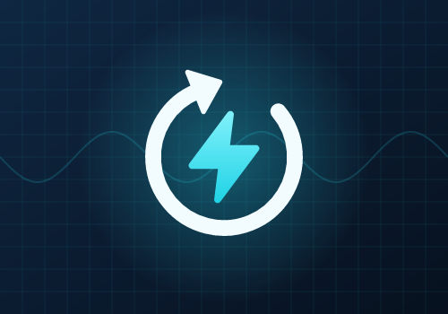

# Tibber Grid Rewards for Homey

[](https://github.com/Marlark/tibbergridrewards/actions/workflows/ci.yml)



Follow your [Tibber Grid Rewards](https://tibber.com) in [Homey](https://homey.app) in real time: what you earn per session, day and month, why your home is or isn't available, and what your car and home battery are doing.

> **Unofficial.** This app is not made, endorsed or supported by Tibber. It uses Tibber's undocumented app API, which can change at any time.

## Features

- **Live status** of Grid Rewards for each home: available, delivering or unavailable, with the reason (e.g. *Excess power in the grid*, *No car plugged in*).
- **Earnings** for the current session (with an estimate while it runs), today, yesterday, this month and all time, logged to Insights.
- **Statistics**: last session, sessions and delivery time today, sessions this month, how much of the day the home was available, and records (best day, best session, longest session).
- **Car and home battery** as their own devices, each with what it earned (today, this month, in total), its sessions, its share of the month, how much of the day it was available, and its records.
  - **Car**: plugged in, smart charging, a daily plug-in reminder, and a check against your charger that warns when Tibber has lost contact with the car.
  - **Battery**: savings, current activity, next planned charge or discharge, the planned charge level until the end of tomorrow, and its day: hours for Grid Rewards, price and solar, and energy in and out.
- **Flow cards** for sessions, daily and monthly summaries, amounts passed, records, long unavailability, the car's plug-in state and the battery's day.
- **Three dashboard widgets**: status, the last 7 days and the battery plan. They update as soon as something changes.
- **History page** in the app settings: every session with its reason, device and Tibber's settlement, totals per day and per reason, records, the battery's plan and days, and CSV export. It is kept even if you remove and add the home again.
- **Six languages**: English, Swedish, Norwegian, Danish, German and Dutch.

## Requirements

- Homey Pro with firmware **12.3** or later.
- A Tibber account with Grid Rewards. You log in with your Tibber e-mail and password.

## Installation

The app is not in the Homey App Store yet. To install it from source you need [Node.js](https://nodejs.org) and the [Homey CLI](https://apps.developer.homey.app/the-basics/getting-started/homey-cli):

```bash
npm install --global homey
git clone https://github.com/Marlark/tibbergridrewards.git
cd tibbergridrewards
npm install
homey app install     # or: homey app run, to see the log while it runs
```

## Setup

1. **Add your home:** *Devices → + → Tibber Grid Rewards → Grid Rewards*. Log in with your Tibber e-mail and password and pick the home(s).
2. **Add your car and battery (optional):** *Grid Rewards → Car / battery (Grid Rewards)*. The list shows what your home device has received from Tibber, so add the home first.
3. **Add a widget (optional):** edit a dashboard, add *Grid Rewards* (status) or *Grid Rewards – last 7 days* (a bar per day) and pick the home, or *Grid Rewards – battery plan* (the planned charge level until the end of tomorrow) and pick the battery.
4. **Set up the car (optional):** in the car's settings, turn on the plug-in reminder and pick a time. For the charger check, make a flow with your charger's or car's own card (e.g. *car connected* / *car disconnected*) and the action card *The charger says the car is plugged in / unplugged*.
5. **See the history:** *Settings → Apps → Tibber Grid Rewards* shows, per home, the last 100 sessions (with reason, device and settlement, filterable per car or battery), totals per day and per reason, and records. For each battery it shows the planned charge level and its days. Sessions and daily totals can be downloaded or copied as CSV. Everything is kept per Tibber home in the app, so removing and adding the home device again does not lose it.

If your Tibber password changes, open the home device and choose **Repair** to enter the new one.

## Devices and values

### Home

| Value | Meaning | Insights |
|---|---|:---:|
| Grid Rewards status | Available, delivering, unavailable or unknown | |
| Session active | A session is in progress | ✔ |
| Reason | Why, e.g. *Excess power in the grid*. When the home is unavailable, the car's or battery's reason is shown too. | |
| Current session | Earned in the session in progress, as reported by Tibber | ✔ |
| Session (estimate) | During a session: Tibber's figure, or the minutes so far × the usual reward per minute for that reason if that is more (Tibber reports with a delay) | ✔ |
| Reward today / this month | This month comes straight from Tibber | ✔ |
| Reward yesterday | Set at midnight and unchanged all day, so Insights shows each day's total as one step | ✔ |
| Total reward | All time | ✔ |
| Last session | Earned in the last finished session | ✔ |
| Sessions today / this month | Number of finished sessions | ✔ |
| Delivery time today | Minutes delivered today | ✔ |
| Available today | Part of the day (%) the home was available or delivering, of the time Homey observed | ✔ |
| Updated | Time of the last update from Tibber. Only when turned on in the device settings, because it is written on every update | |

The device settings also show the **connection status**: connected, reconnecting, login failed or *Tibber has changed its API*, the last update from Tibber and the number of reconnects.

### Car and battery

| Value | Car | Battery | Insights |
|---|:---:|:---:|:---:|
| Grid Rewards status and reason | ✔ | ✔ | |
| Earned today / this month / in total | ✔ | ✔ | ✔ |
| Share of what the car and battery earned this month (%) | ✔ | ✔ | ✔ |
| Sessions today / this month, delivery time today | ✔ | ✔ | ✔ |
| Available today (%) | ✔ | ✔ | ✔ |
| Smart control on | ✔ | ✔ | ✔ |
| Plugged in | ✔ | | ✔ |
| Savings today / this week / this month | | ✔ | ✔ |
| Battery activity, e.g. *Charging with solar power* | | ✔ | |
| Next planned activity, e.g. *Discharge at 14:30 (2.5 kW)* | | ✔ | |
| Grid Rewards / price control / solar today (hours charging or discharging) | | ✔ | ✔ |
| Charged / discharged today (kWh) | | ✔ | ✔ |

Tibber only reports the reward for the whole home, so each session is credited to the car or battery that delivered during it (see [How it works](#how-it-works)).

Battery details are fetched every 5 minutes, and about 10 seconds after a Grid Rewards status change (at most once a minute), so the battery's activity follows a session straight away. If Tibber can't deliver them, the battery keeps its last values; a warning is shown only after about 15 minutes of failures, so Tibber's short outages don't make it flash.

The battery's kWh assume that Tibber reports average power (W) per quarter. That is not yet verified against a real battery; if the figures look 4 times too high or too low, please open an issue.

**Car settings:** a daily *plug-in reminder* at a time you choose (a notification and a flow card, only if the car is not plugged in), and the *charger check*: report your charger's state with the action card *The charger says the car is …*; if it says plugged in but Tibber sees no car for 10 minutes, the car shows a warning. The settings show what the charger last reported.

Money is shown in Tibber's currency: SEK, NOK and DKK as *kr*, EUR as *€*.

## Flow cards

**Home**

| | Cards |
|---|---|
| When | Status changed · Session started · Session ended (reward, duration) · Daily summary at midnight · Monthly summary when a new month starts · Reward today / this month passed *X* · Unavailable for *X* hours · A new record was set |
| And | A session is active · Status is … · Reward today is above *X* |

**Car and battery**

| | Cards |
|---|---|
| When | Status changed · Session ended (the device's share) · A new record was set · Smart control was turned off · Smart control was turned on or off · Unavailable for *X* hours |
| When, car | The car was plugged in or unplugged · Reminder: the car is not plugged in · The charger and Tibber disagree |
| When, battery | The battery activity changed · The battery's day (after midnight: hours per reason, kWh, savings) |
| And | The car is plugged in · Smart control is on · Grid Rewards is available · Status is … |
| Then, car | The charger says the car is plugged in / unplugged |

Good to know:

- Cards with a reason also have a **reason code** token (e.g. `noVehiclesPluggedIn`). Use it in conditions; it does not change with Homey's language.
- *Reward passed X* runs once per day or month when the amount is passed. *Unavailable for X hours* runs once per unavailable period.
- *Smart control was turned off* is worth a notification: Grid Rewards needs smart charging (car) or smart mode (battery).
- *Session ended* fires up to 3 minutes after the session, because Tibber pays out the last quarter about 40 seconds after it ends. Waiting includes that in the reward.

## Privacy and risks

- Your Tibber **password is stored on your Homey** (in the device), because Tibber's app API has no way to renew a login without it. The Home Assistant integration works the same way. Nothing is sent anywhere except to Tibber.
- The API is **undocumented**. If Tibber changes it, the device becomes unavailable with a clear message, you get one notification, and the app retries every hour.

## How it works

The app logs in like the Tibber mobile app and subscribes to `gridRewardStatus` over a WebSocket. Earnings per day and session are derived from Tibber's month total:

- **today** = month total − month total at the start of the day
- **session** = month total − month total when the session started
- **car / battery** = the sessions it delivered in. Tibber only reports the home's total, but each car and battery has its own status, and in real data only one of them delivers at a time. If both deliver during the same session, its reward is split evenly. Counted from when you update to the first version with this feature; earlier sessions are not split.

This is robust where it matters:

- Counters are kept **per home**, so several homes or accounts don't mix.
- Homes on the same Tibber account share **one login and one WebSocket**, with a subscription per home. Repairing one of them updates the password for the others too.
- The day rollover uses Homey's time zone and works even if Homey was off at midnight.
- A small downward correction from Tibber is not mistaken for a new month, and a late month reset is still detected.
- Reconnects use exponential backoff (5 s → 5 min). The app pings every minute and reconnects if nothing arrives for 3 minutes.
- After a wrong password, login is retried only every 6 hours, to avoid locking the account.
- Values are only written to Homey when they change: on a real day about 500 writes to the home device instead of 1,500.

Thanks to [JohNan/homeassistant-tibber_grid_rewards](https://github.com/JohNan/homeassistant-tibber_grid_rewards), whose work showed how Tibber's app API is used.

## Development

```bash
npm install     # installs ws
npm test        # all tests; no Homey or Tibber account needed
homey app run   # run on your Homey with the log in the terminal
```

GitHub Actions runs the tests and `homey app validate --level publish` on every push.

### Project layout

```
lib/                 Logic without Homey dependencies (tested on its own)
  HomeStore.js         What is kept per home in the app settings (history, days, records, …)
  devices.js           Finding the home, car and battery devices
  TibberAppClient.js   Login and GraphQL over HTTP
  GridRewardSubscription.js  WebSocket with one subscription per home, reconnects, API-change detection
  ConnectionPool.js    One login and WebSocket per Tibber account, shared by its homes
  RewardTracker.js     Today, sessions, settlement, day/month rollover
  battery.js           Battery query and parsing
  planChart.js         The battery plan curve (SVG), for the settings page and widget
  csv.js               CSV export of sessions and daily totals
  flexEarnings.js      What each car/battery earned, from the sessions it delivered in
  availability.js      "Available today" in %
  records.js           Best day, best session, longest session
  carChecks.js         Plug-in reminder and check against the charger
  batteryDay.js        The battery's day: hours per reason, energy in and out
  reasonStats.js       Sessions per reason, and the estimate of a running session
drivers/grid-reward/ The home device (login, subscription, flow cards)
drivers/flex-device/ Car and battery, fed by the home device
widgets/             Dashboard widgets: status, last 7 days, battery plan
settings/            Session history page (served by api.js)
locales/             Translations (en, sv, no, da, de, nl)
test/                Tests, with a stub of the homey module in test/helpers/
tools/               Recording, replay and login inspection
```

### Translations

Texts live in `locales/*.json` and in the `.homeycompose/` and `drivers/*/` manifests. `test/i18n.test.js` fails if a text is missing in a language or a placeholder such as `__time__` or `[[amount]]` is lost.

The Norwegian, Danish, German and Dutch texts were machine-assisted. Corrections from native speakers are welcome.

New battery activity codes are logged as `Unknown battery activity "…"` and shown in readable English until they are added under `battery_activity` in `locales/*.json`. Seen so far: `ChargingForGridRewards`, `DischargingForGridRewards`, `IdleForGridRewards`, `IdleWithUpcomingLowPrice`, `IdleWithUpcomingHighPrice`, `ChargingWithSolarProduction`, `ChargingAtLowPrice`, `DischargingAtHighPrice`, `DischargingWithUpcomingSolar`.

### Recording real data

To see exactly what Tibber sends, and to turn it into a test:

1. Run the app and save the log: `homey app run | tee run.log`. During `homey app run` every update from Tibber is logged as a `[REC]` line; a published app never does this. To run without it, put `{ "RECORD_RAW": "0" }` in `env.json` (ignored by git).
2. Extract the recording: `node tools/extract-recording.js run.log > recordings/my-day.jsonl`. The battery's responses are logged as `[REC-BATTERY]` lines; extract them with `--battery`.
3. Replay it: `node tools/replay.js recordings/my-day.jsonl` prints every update and lists impossible values.
4. To keep it as a test, anonymise it first: `node tools/anonymize-recording.js recordings/my-day.jsonl > test/fixtures/my-day.jsonl`

`run.log` and `recordings/` are ignored by git, because they contain your home, car and battery ids and the names you gave them (often an address). The anonymiser replaces those and refuses to write anything if an original value would remain. Every file in `test/fixtures/` is replayed by `npm test`.

## More

- [Homey Community topic](https://community.homey.app/t/162451): questions, ideas and test versions. Bugs are best reported as [GitHub issues](https://github.com/Marlark/tibbergridrewards/issues).
- [CHANGELOG.md](CHANGELOG.md): what has changed.
- [Docs/IDEBANK.md](Docs/IDEBANK.md): ideas for future features (in Swedish).

## License

[MIT](LICENSE). The license covers this code only; it gives no rights to Tibber's API, name or brand.
